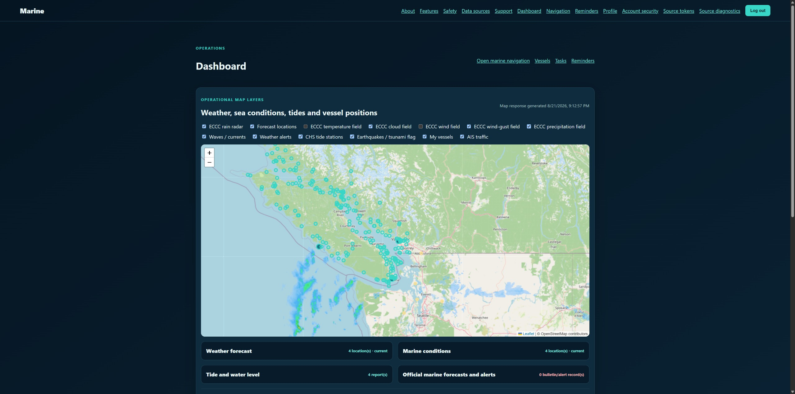

# Open Marine Dashboard

Open Marine Dashboard is an open-source Laravel 12 application for private, per-user vessel operations. It provides vessel and equipment records, maintenance schedules and reminders, tasks, weather and marine-condition context, safety-alert layers, and supplementary navigation-planning tools.



This public repository is a sanitized source release derived from the production Marine project. It contains no production configuration, credentials, user data, deployment history, or private operational documentation.

## Capabilities

- Account registration, email verification, password recovery, and audited administrator provisioning
- Owner-scoped vessels, equipment, tasks, positions, maintenance schedules, completions, reversals, and reminders
- Weather, marine conditions, ECCC alert/radar context, CHS stations, and USGS earthquake context
- Interactive supplementary map and route-sketching workspace
- User-funded optional provider credentials stored through encrypted model casts
- Cross-user authorization regression coverage and security-focused middleware

## Requirements

- PHP 8.4.1 or newer
- Composer
- SQLite for local development, or a supported MySQL/MariaDB database

## Local installation

```bash
git clone https://github.com/tocsindata/open-marine-dashboard.git
cd open-marine-dashboard
cp .env.example .env
composer install
php artisan key:generate
touch database/database.sqlite
php artisan migrate
php artisan test
php artisan serve
```

For scheduled imports, configure one system scheduler entry:

```cron
* * * * * cd /path/to/open-marine-dashboard && php artisan schedule:run >> /dev/null 2>&1
```

## Safety notice

This software provides supplementary situational-awareness and planning information. It is not ECDIS, a certified chart system, an official warning service, or a substitute for official charts, notices, forecasts, emergency alerts, prudent seamanship, or legally required equipment.

## Security

Do not report vulnerabilities in public issues. See [SECURITY.md](SECURITY.md).

## License

Copyright (c) 2026 Tocsin Data.

Licensed under the GNU Affero General Public License v3.0. See [LICENSE](LICENSE).

ACTIVE STAMP: 09-22-2026
